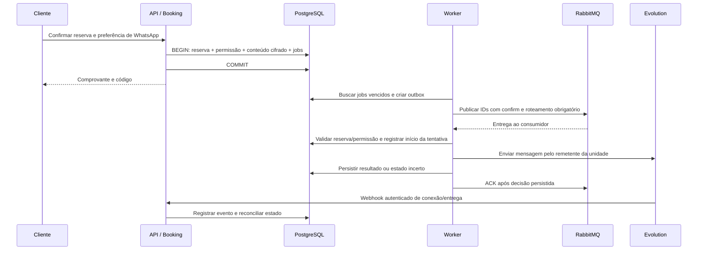

# Worker de notificações e WhatsApp por barbearia

Criado em 2026-10-31; atualizado em 2026-11-01. Entregas A e B implementadas;
backend/ambiente da entrega C implementados e testados com QR e callback reais.
Pareamento de telefone e verificação de desconexão real ainda pendentes.
Entregas D–G planejadas.
Os envios ainda não estão implementados nem habilitados no runtime.
Decisão de arquitetura: [ADR 0038](adr/0038-shop-whatsapp-notification-worker.md).

## 1. Objetivo e decisões de produto

Cada barbearia terá uma conexão WhatsApp, configurada pelo proprietário. Todos
os profissionais da unidade usarão esse remetente. O número do cliente continua
sendo um contato do agendamento, sem criar conta ou painel de clientes.

Primeira versão:

- Mensagem de confirmação depois que a reserva for persistida, com barbearia,
  endereço, profissional, serviço, data/hora local, preço/moeda e código privado.
- Um lembrete antes do atendimento, com essas informações e o mesmo código.
- Antecedência padrão de 24 horas, editável por unidade. Proposta inicial:
  minutos inteiros de 5 a 10.080, apresentados como minutos/horas/dias no painel.
- Conectar por QR code, consultar situação e reconectar em Configurações.
- Mostrar conexão e falhas de envio separadamente, com última verificação.

Ajuste de implantação em 2026-11-01: inicialmente a API ficará no Web Service
gratuito da Render, sem processo worker. Nesse estágio, tentar a confirmação na
requisição que criou a reserva, após o commit, e disponibilizar lembrete manual
na agenda. Lembrete automático configurável permanece previsto para a ativação
do worker. A seção 10.1 detalha essa transição; envio ainda não está implementado.

“Um dia antes” significa inicialmente 24 horas decorridas antes de starts_at.
Exemplo: terça às 09:30 gera lembrete segunda às 09:30, em datas sem mudança de
offset. Os instantes são UTC e a apresentação usa o fuso IANA da barbearia.
Agendar para “o dia civil anterior às 18h” seria outra política, fora desta versão.

Se a reserva acontecer dentro da antecedência escolhida, mandar a confirmação e
registrar o lembrete como dispensado por antecedência insuficiente. Não disparar
duas mensagens juntas. Exemplo: reserva hoje para daqui a 3h, com política de 24h.

Configuração de antecedência vale para novas reservas. Não alterar silenciosamente
jobs existentes; guardar a versão da política utilizada. Desativar notificações
ou revogar permissão, por outro lado, impede os envios ainda não iniciados,
inclusive os já enfileirados. Reprogramação em lote poderá ser uma ação posterior.

Mensagens não são pré-requisito para reservar: cliente sem autorização de WhatsApp
continua recebendo o comprovante na tela. A confirmação da reserva é diferente de
entrega/leitura de mensagem e de confirmação de presença do cliente.

Não incluir nesta fase campanhas, respostas SIM/NÃO, IA, chat de suporte,
lembrete por profissional, envio de cancelamento ou implantação AWS. Cancelar
precisa invalidar as mensagens pendentes, mesmo sem enviar uma nova mensagem.

## 2. Validação inicial do projeto

A revisão foi direcionada às fronteiras de booking, customers, notifications,
composição e runtime do worker. Não equivale a auditoria completa do SaaS.

| Parte atual | Situação observada | Consequência para esta entrega |
| --- | --- | --- |
| BookingTransactor / BookingTx | Compartilham a transação PostgreSQL entre adaptadores | Acrescentar planejamento dentro dessa mesma transação |
| CreateAppointment.Execute | Planeja notificações na mesma transação, somente em criação nova | Replay não cria mensagens nem faz backfill |
| CancelAppointment / lifecycle administrativo | Triggers invalidam jobs junto com o estado da reserva | Consumer ainda revalidará elegibilidade antes de enviar |
| Código privado | Hash na reserva; recibo cifrado com chave da requisição do cliente | Worker não consegue recuperar autonomamente o código atual |
| Customers | Normaliza telefone, resolve contato e grava permissão transacional por reserva | Telefone sozinho não significa autorização de mensagens |
| notifications | Planejamento durável e gestão de conexão Evolution implementados | Faltam transporte de mensagens, sender e interface |
| cmd/worker e internal/worker | Abrem dependências e verificam disponibilidade | Ainda não consomem filas nem enviam notificações |
| RabbitMQ | Cliente AMQP e ambiente local já existem | Falta topologia, relay, confirms, consumer, ACK, reconexão e DLQ |
| API / worker | Executáveis do mesmo módulo Go | Manter o monólito modular com processos separados |

Verificações executadas nesta revisão:

- `go vet ./...` e `go test ./...`: passaram; parte dos testes reutilizou cache.
- Builds de `cmd/api` e `cmd/worker`: passaram, com saída em pasta temporária.
- `docker compose --env-file .env.example config --quiet`: passou.
- `npm run typecheck` no frontend: passou.

Não foram repetidos testes PostgreSQL de integração, testes completos de navegador
ou login com a conta real. Não houve conexão de telefone, envio real, implantação
da Evolution ou alteração no Supabase. README e doc.go permanecem preservados.

## 3. Arquitetura e responsabilidade dos módulos

Manter o módulo notifications existente. O worker é outro executável do mesmo
backend, com o mesmo código de domínio e acesso ao banco. Não criar agora um
microsserviço, outro repositório, outro go.mod ou serviço Python.

| Parte | Responsabilidade |
| --- | --- |
| booking | Reserva, calendário, snapshots, código de consulta e estado do atendimento |
| customers | Telefone normalizado e autorização/revogação de mensagens transacionais |
| notifications/domain | Política de lembrete, elegibilidade temporal, estados e regras de tentativas |
| notifications/application | Planejar, invalidar, liberar jobs vencidos, entregar e reconciliar resultados/conexão |
| notifications/infra/postgres | Configuração, jobs, conteúdo protegido, outbox, leases e tentativas |
| notifications/infra/evolution | HTTP da Evolution, DTOs do provedor e interpretação de resultados |
| notifications/infra/rabbitmq | Publicação/consumo e topologia das notificações |
| notifications/infra/http | Rotas administrativas e entrada autenticada de webhooks |
| internal/platform | Recursos genéricos compartilhados: pool, AMQP, configuração e ciclo de vida |
| cmd/api / cmd/worker | Montar dependências; não conter regras de negócio |

Booking declara uma porta pequena de planejamento/invalidação em seu próprio
application. A composição injeta um adaptador ligado às mesmas Queries da
transação. Booking/application não importa notifications/infra ou seu domínio.
Notifications também consulta elegibilidade atual por porta própria, implementada
pelos adaptadores dos módulos donos dos dados.

Os nomes e arquivos abaixo são candidatos para entregas reais, não arquivos vazios
a serem criados antecipadamente:

```text
internal/modules/notifications/
  domain/                 policy.go, notification.go, connection.go
  application/            dto.go, ports.go, plan_booking.go, deliver.go,
                          release_due.go, manage_connection.go, delivery_result.go
  infra/postgres/         repositórios ligados ao pool/Queries/tx compartilhados
  infra/rabbitmq/         relay, consumer e declaração da topologia
  infra/evolution/        cliente HTTP e verificação/interpretação de eventos
  infra/http/             handlers e DTOs de transporte
  tests/domain/           limites temporais, transições e tentativas
  tests/application/      elegibilidade, falhas e adaptador falso determinístico
  tests/infra/            contrato HTTP, autenticação e mensagens inválidas
tests/integration/        atomicidade, concorrência e recuperação reais
```

## 4. Fluxo de uma reserva e do lembrete



Confirmação: due_at é o instante de criação. “Na hora” significa processamento
assíncrono logo depois do commit, sem aguardar WhatsApp no POST de agendamento.
Meta inicial saudável: publicação em até 5s e início de envio em até 30s. São metas
de operação local, não promessa de entrega do WhatsApp nesse prazo.

Lembrete: due_at = starts_at - reminder_lead_minutes. Não deixar um processo
dormindo até essa hora. Guardar due_at no PostgreSQL; o scheduler busca vencidos
e recupera trabalho após reinício.

Prazo proposto: confirmação expira em min(created_at + 1h, starts_at); lembrete
expira em min(due_at + 1h, starts_at - 1min). Se não houver janela válida, registrar
como dispensado/expirado. Depois de uma pane, não mandar mensagens antigas em
massa. Esses limites serão constantes explícitas e testadas na primeira entrega.

Ajuste da entrega A: a margem foi reduzida de 5min para 1min para que a
antecedência mínima configurável de 5min tenha uma janela útil de 4min.
O instante inicial é inclusivo e a expiração é exclusiva. Horários planejados
usam UTC e precisão de microssegundos, preservada pelo PostgreSQL.

## 5. Persistência, atomicidade e isolamento

Persistência atual da entrega B e estruturas previstas para as entregas seguintes:

| Estrutura proposta | Dados principais |
| --- | --- |
| shop_notification_settings | Uma política por unidade: habilitação, antecedência, versão, auditoria |
| shop_whatsapp_connections | Uma conexão por unidade: ID remoto opaco, geração, situação e verificações |
| customer_booking_message_permissions | Implementada: autorização por reserva, finalidade, origem, ator e revogação |
| appointment_notification_plans | Implementada: versão/geração, dispensa ou snapshot cifrado, chave e expiração |
| notification_jobs | Implementada: intenção por tipo/geração, due_at, expires_at e pending/invalidated; transporte acrescentará dispatch_seq, lease e retries |
| notification_outbox | Envelope publicável ligado ao job e dispatch_seq; publicação e lease |
| notification_attempts | Tentativas com início, resultado, ID do provedor e categoria de erro sanitizada |
| Entrada de eventos do provedor | Inbox deduplicável e restrita aos campos necessários para reconciliar eventos |

O job representa a intenção e seu agendamento; não criar outra tabela equivalente
de lembretes sem necessidade. Permissões pertencem a customers e terão referência
ao contato/unidade/reserva, finalidade, origem, versão do aviso, instante e revogação.

Criar reserva, permissão aplicável, payload protegido e jobs na MESMA transação.
O scheduler transforma um job vencido em outbox numa segunda transação curta.
Se a política estiver desligada ou faltar permissão, não criar mensagens enviáveis.
Falha de gravação de uma intenção obrigatória causa rollback completo; falha
externa de broker/provedor não participa dessa transação nem bloqueia a API.

Constraints previstas:

- FKs compostas com shop_id para reserva, job, payload, tentativa e outbox.
- UNIQUE por (shop_id, appointment_id, kind, schedule_generation).
- UNIQUE por (shop_id, job_id, dispatch_seq) na outbox.
- UNIQUE por (shop_id, job_id, attempt_number) nas tentativas.
- Um remetente configurado por shop_id e mapeamento remoto exclusivo.
- CHECKs para antecedência, estados, janelas e números de tentativa válidos.
- Índices parciais de trabalho pendente por due_at/next_attempt_at e lease vencido.
- RLS/grants de servidor coerentes com as tabelas atuais, sem expor dados à Data API.

Repetir a requisição de criação com a mesma chave retorna o comprovante original;
não planeja outra confirmação/lembrete. UNIQUE reforça essa regra no banco.
Reservas antigas não ganham mensagens automaticamente na migration. Ativar para
novas reservas; eventual backfill precisa de operação explícita e código recuperável.

## 6. Código privado, telefone e permissão

O código atual permite consultar/cancelar a reserva; tratá-lo como segredo.
O hash de appointments não permite recuperar o código. O recibo de idempotência
é cifrado com uma chave da requisição que o servidor não guarda, e sua validade
é de 24h. Portanto nem um job executado imediatamente pode depender de conseguir
decifrá-lo autonomamente. Não alterar esse mecanismo para resolver o worker.

Na criação nova, quando o código ainda existe em memória, produzir separadamente
um snapshot cifrado para notifications. Usar AEAD da biblioteca padrão, chave
servidor de 32 bytes, key_id e AAD com protocolo/tenant/reserva. API cifra e worker
decifra; erros não contêm texto, telefone, chave ou código. Reter até o fim das
janelas de envio, com limpeza após prazo definido. Planejar rotação que preserve
leitura das chaves antigas até a expiração dos payloads.

Não usar a chave da Stripe, do Supabase ou da Evolution para isso. Não persistir
a chave de idempotência do cliente. Não colocar código, telefone ou corpo na fila,
URL de consulta, métricas ou logs. Mostrar código no corpo destinado ao cliente;
linkar a tela de consulta da unidade sem inserir o código em query string.

O telefone deve ser E.164; o adaptador converte para o formato exigido pela versão
da Evolution. Enviar ao destino autorizado no snapshot da reserva; não trocar
silenciosamente por um telefone atual de outro cadastro ou por conteúdo do webhook.

No agendamento público, oferecer opção clara de receber confirmação e lembrete.
Em reserva manual, registrar que o funcionário coletou essa autorização para o
contato informado. Não permitir o envio só porque um telefone foi digitado. Não
incluir finalidade de marketing. Antes de cada tentativa conferir revogação atual.
Essa informação serve ao fluxo de mensagens; não cria um módulo CRM.

## 7. Worker, RabbitMQ e recuperação

Um processo cmd/worker pode coordenar scheduler, relay, consumer e reconciliação
com goroutines supervisionadas. Separar componentes para testar, compartilhando
pool e gerenciando canais/conexões AMQP adequadamente.

1. Scheduler reclama lotes com FOR UPDATE SKIP LOCKED, grava outbox e avança o job
   atomicamente. Usar relógio do banco para claims/prazos e leases com token.
2. Relay publica apenas IDs e versão do envelope, com mensagem persistente,
   publisher confirm e mandatory. Confirm sozinho não prova que houve roteamento.
3. Só marcar publicação após confirm positivo e ausência de retorno. Resultado
   incerto pode republicar o mesmo dispatch_seq, que o consumidor deduplica.
4. Consumer usa ACK manual e prefetch limitado. Envelope inválido vai para DLQ
   com metadados sanitizados; não requeue infinito de mensagem irrecuperável.
5. Reclamar o job, revalidar unidade/reserva/permissão/conexão e iniciar tentativa
   numa transação curta. Entrega antiga com dispatch_seq superado não envia.
6. Executar HTTP fora da transação e persistir resultado antes de ACK. Falha de
   persistência impede ACK; redelivery não deve repetir uma tentativa incerta.
7. Falha sabidamente anterior ao envio pode gerar próxima tentativa persistida
   com backoff/jitter, no máximo 5 tentativas e sempre respeitando expires_at.
8. Falha definitiva vai para failed. Timeout/reset depois de possível envio vira
   unknown; reconciliar, sem novo envio automático cego.

Topologia proposta: exchange barber.notifications, routing key whatsapp.send,
fila barber.notifications.whatsapp e DLX/fila barber.notifications.dead.
PostgreSQL continua dono dos atrasos e retries; não usar plugin de delay ou TTL
de fila como agenda principal. A DLQ ajuda a operação; o estado no banco continua
sendo necessário para inspeção e retomada auditável.

Lease expirado antes de iniciar I/O pode ser recuperado. Tentativa marcada como
iniciada com resultado ausente é ambígua e exige reconciliação. Fencing impede
escritas de um dono antigo, mas não desfaz uma mensagem externa já enviada.

Não presumir que sendText aceita idempotency key: o DTO público consultado não
estabelece essa garantia. Correlacionar pelo ID do provedor quando conhecido;
se não houver prova suficiente, manter unknown e disponibilizar revisão controlada.
Não procurar mensagens por semelhança de texto/horário e considerá-las uma prova.

Reconectar AMQP com backoff/jitter, recriar topologia/consumers e recuperar leases.
Shutdown cancela novos claims, drena I/O com prazo, persiste o que for possível e
fecha canais para devolver mensagens unacked. Banco/broker indisponível reduz
capacidade do worker, não desabilita a reserva na API.

## 8. Cancelamento, mudanças e corridas

Integrar invalidação na transação do cancelamento público e da mudança de estado
administrativa. O consumer também consulta a situação atual: mensagens antigas
em RabbitMQ não podem ignorar a invalidação no PostgreSQL.

Usar o mesmo protocolo de locks já existente (profissional antes da reserva),
seguido pelos jobs. Não adquirir locks em ordem inversa no worker. A decisão de
iniciar envio ocorre sob essa coordenação e é persistida antes de chamar o provider.

Se cancelamento vencer a disputa, o envio não se inicia. Se a tentativa já tiver
sido iniciada, não é possível garantir que a mensagem seja retirada do WhatsApp.
Não segurar a transação da reserva aberta durante a chamada HTTP para fingir essa
garantia. Documentar e testar a fronteira de envio em andamento.

Validar estado atual e assinatura do agendamento (profissional, início/fim,
destinatário e geração). Não descartar lembrete apenas porque uma versão geral
mudou por razão irrelevante. Cancelled, no_show, completed e horário passado não
recebem lembrete. Mudança de horário/destino futuramente exige nova geração e
invalidação atômica da antiga; não implementar reagendamento só para este worker.

Assinatura comercial habilita novas reservas pelas regras existentes. Para uma
reserva já aceita, não suprimir lembrete só por uma cobrança posterior pendente;
loja desativada, permissão revogada ou WhatsApp desabilitado impedem o envio.

## 9. Evolution local, conexão e monitoramento

Preparar um Compose separado/opcional para Evolution, PostgreSQL próprio e Redis,
com volumes exclusivos. Não apontar as migrations da Evolution para o banco do
Barber-chat ou para o Supabase. Redis atende o provider; os jobs do produto
continuam no PostgreSQL do backend. Não ligar o RabbitMQ interno da Evolution
à fila de negócio: preferir webhooks para os eventos necessários.

Serviço publicado só em loopback, por exemplo 127.0.0.1:8081. API Go permanece
127.0.0.1:8080 no uso comum do host. Webhook de container para host Windows exige
endereço alcançável: usar host.docker.internal e listener de desenvolvimento
configurado para a interface apropriada, com regra local de acesso; o listener
127.0.0.1 sozinho não basta. Alternativa: API em container na mesma rede privada.
Não trocar o listener do usuário silenciosamente nem expor um túnel público.

Antes de escolher imagem, revisar tag, digest, dependências e contrato. A release
estável listada na consulta foi 2.3.7, mas há aviso concreto sobre a dependência
Baileys dessa versão: GHSA-qvv5-jq5g-4cgg, com correção na linha 7 em rc12 ou
posterior. A issue #2686 relaciona esse problema à release. Não fixar 2.3.7 como
recomendação segura nem usar latest para contornar. Validar uma distribuição
corrigida e seus requisitos operacionais antes de parear o telefone. A fase de
worker com adaptador falso pode avançar independentemente dessa escolha.

Contrato de integração a confirmar na imagem selecionada; rotas verificadas no
código oficial de referência 2.3.7:

| Operação | Rota da Evolution |
| --- | --- |
| Criar instância | POST /instance/create |
| Conectar/obter desafio | GET /instance/connect/{instance} |
| Verificar conexão | GET /instance/connectionState/{instance} |
| Configurar webhook | POST /webhook/set/{instance} |
| Enviar texto | POST /message/sendText/{instance} |
| Desconectar deliberadamente | DELETE /instance/logout/{instance} |

O backend gera nome remoto opaco ligado ao shop_id, independente do slug. Não
aceitar instance name, base URL ou API key arbitrários enviados pelo navegador.
Segredos ficam no backend/worker. Criar instância deve ser reconciliável por nome
estável se houver timeout; não criar várias instâncias ou apagar a sessão para
resolver um erro transitório. Preservar volumes de sessões.

Situações normalizadas para o painel: not_configured, connecting, qr_required,
connected, disconnected e unknown. Persistir observação, última verificação
ativa, última conexão bem-sucedida e código de erro sanitizado. Proposta de
reconciliação ativa: 60s; após 120s sem confirmação, mostrar estado desatualizado,
em vez de afirmar que continua conectado. QR é efêmero, restrito ao owner, sem
armazenamento duradouro/cache/log. Novo pareamento incrementa a geração.

Receber apenas eventos necessários: conexão, desafio QR e atualização de envio/
entrega. No código consultado, webhook por instância suporta headers próprios;
usar segredo exclusivo nesse header e validação em tempo constante. Não inventar
verificação HMAC do corpo se o contrato selecionado não a oferecer. Validar também
instância/geração, tamanho, esquema e tipos de evento. Não logar o payload bruto:
ele pode carregar apikey, telefone e outros dados do provedor.

Webhooks repetidos precisam ser idempotentes. Eventos atrasados não devem
regredir delivered para accepted. Se faltar ordenação confiável de conexão,
o evento solicita nova consulta ativa em vez de se tornar verdade definitiva.
Persistir evento relevante antes de responder sucesso; trabalho pesado fica fora
do handler. Usar uma inbox mínima, sem guardar histórico inteiro de conversas.

Conexão conectada não prova entrega. Aceitação do POST significa accepted quando
o contrato/ID forem válidos; delivered/read só com evento correlacionado confiável.
Não usar número de telefone isoladamente para correlacionar tenants.

## 10. Painel e contratos HTTP propostos

Rotas propostas, ainda não fazem parte da API executável nem do OpenAPI atual:

| Rota sob /api/v1/admin/shops/{slug} | Finalidade |
| --- | --- |
| GET /notifications/settings | Ler política e versão |
| PUT /notifications/settings | Owner altera habilitação e antecedência com versão esperada |
| GET /whatsapp/connection | Implementado: estado normalizado, freshness e última verificação; sem consultar número/perfil |
| POST /whatsapp/connect | Implementado: owner cria/reutiliza instância e recebe desafio temporário com no-store |
| POST /whatsapp/disconnect | Implementado: owner solicita logout deliberado |
| GET /notifications | Owner consulta situação dos jobs, com paginação e filtros |

Webhook implementado: POST /api/v1/webhooks/evolution, com token por instância,
sem Bearer Supabase. As demais rotas usam autenticação + acesso à unidade + owner,
inclusive para QR e dados de conexão. Serviço de aplicação revalida autorização;
ocultar botão no frontend não é controle de acesso.

Primeiro painel: seção WhatsApp em Configurações, sem ampliar desnecessariamente
o menu. Mostrar remetente mascarado, estado textual, horário de verificação,
conectar/reconectar, desativar envios e antecedência. Saúde do worker é informação
distinta da conexão do telefone. Mostrar problemas na confirmação/lembrete do
atendimento sem expor o conteúdo privado inteiro. Não oferecer retry automático
de uma escrita ou envio com resultado incerto.

Mensagens iniciais usam template interno versionado; sem editor livre. Não
expor credenciais ou o snapshot cifrado ao JavaScript nem chamar Evolution pelo
navegador. O painel recebe apenas os dados autorizados necessários à interface.

## 10.1 Operação inicial sem worker — Render Free

### Comportamento de produto

O proprietário e a conta de barbeiro vinculada ao profissional podem solicitar
lembrete na agenda, respeitando os mesmos escopos dos atendimentos. Proprietário
pode atuar em qualquer profissional da unidade; barbeiro somente no seu próprio
atendimento. A permissão de WhatsApp do cliente e as configurações da unidade
continuam obrigatórias para confirmação e lembrete. Acesso à agenda não permite
ignorar consentimento ou enviar para outro número arbitrário.

Na criação pública ou administrativa, gravar reserva, permissão e intenção de
confirmação na transação existente. Depois do commit, a composição HTTP chama um
caso de uso de tentativa de envio com prazo curto, fora da transação. A reserva
continua sendo sucesso quando o WhatsApp falha. Mostrar distintamente reserva
confirmada, mensagem aceita pelo provedor, falha conhecida ou resultado incerto.
Aceitação não significa entrega/leitura. Replay da criação não dispara nova
mensagem; a tentativa é protegida no banco, não por estado de botão ou aba aberta.

Não usar goroutine descartável depois de responder, nem depender do navegador
para disparar a confirmação. Sem worker ativo, uma falha entre commit e tentativa
pode deixar confirmação pendente. Persistência permite inspeção/retomada manual,
mas não garante recuperação automática. Prever ação explícita de tentar a
confirmação pendente quando comprovadamente não enviada; timeout ambíguo não
autoriza repetição automática. Essa limitação deve aparecer na UI, sem desfazer
reserva nem incentivar a recriação do agendamento.

O botão Enviar lembrete faz POST autenticado separado. Mostrar ação em andamento,
última tentativa e resultado; cliques concorrentes devem disputar um único claim.
No primeiro corte, no máximo um lembrete aceito por reserva/geração; não oferecer
reenvios ilimitados. A consulta de estado recupera resultado depois de refresh.
Limites por unidade/ator e janela válida precisam ser impostos no servidor.

O lembrete manual pode ser solicitado antes da antecedência automática, desde
que a reserva esteja ativa e no futuro. Não reutilizar a janela expirada do job
automático nem reabrir registro invalidado. Definir uma intenção manual própria,
deduplicável por unidade/reserva/geração, com prazo até antes do início. Se o
automático existir no futuro, ambos devem compartilhar a exclusão por finalidade
para impedir dois lembretes para a mesma geração. Invalidar todas as intenções
afetadas em cancelamento, conclusão, ausência, revogação e mudança de geração.

A validade do snapshot cifrado atual acompanha as janelas automáticas. O modo
manual precisa planejar sua própria janela e retenção desde a criação, limitada
ao início do atendimento com margem, para poder recuperar telefone/código no
momento do clique. Não ignorar expires_at do cipher nem estender silenciosamente
payload já expirado. Reservas anteriores sem snapshot válido não podem prometer
esse envio com o código original; o banco guarda seu hash, não o código legível.

### Estrutura compartilhada e ativação posterior

Criar um caso de uso de entrega independente de HTTP e AMQP: valida elegibilidade,
obtém claim transacional, registra início, chama sender fora do banco e persiste
resultado. Portas pequenas para leitura atual, armazenamento, decifragem e sender;
usar o cliente Evolution existente como base do adaptador. API e futuro consumer
compartilham esse caso de uso e o mesmo protocolo de tentativas. Não duplicar o
envio em handlers nem permitir que worker e API enviem a mesma intenção.

Separar planejamento/armazenamento de execução automática. No estágio Render,
não executar scheduler, relay ou consumer, nem exigir RabbitMQ para subir a API.
Não acumular lembretes automáticos que serão disparados em lote ao migrar. A
ativação futura só libera trabalho explicitamente elegível, ainda no prazo;
reservas anteriores não recebem backfill silencioso. Escolher nomes das opções
de runtime quando houver consumidores reais; nenhuma nova variável é exigida
por este planejamento.

O executável cmd/worker já existe como fundação, mas ainda não contém scheduler,
relay/consumer de notificações. Pode ser concluído e testado localmente, ficando
fora do deploy Render. Na AWS, iniciar processo separado e configurar transporte,
permissões e modo automático; não reescrever o domínio ou o sender. A execução
automática não depende de ser AWS: depende de um processo continuamente operado.

### Infraestrutura e limites

A Render informa que o serviço gratuito dorme após 15min sem tráfego, pode
reiniciar e não oferece disco persistente nem Background Worker gratuito. Logo,
timer/loop interno da API não garante lembrete na hora configurada. O monitor de
conexão existente também pausa junto da API; apresentar verified_at/stale e obter
uma observação atual quando necessário, sem prometer monitoramento contínuo.

Banco e intenções continuam no Supabase. A Evolution é outro serviço: precisa
estar acessível pelo backend hospedado, com autenticação, HTTPS e sessões
persistentes. localhost/127.0.0.1 e host.docker.internal do ambiente local não
apontam para o PC do desenvolvedor a partir da Render. Não subir a stack local
inteira dentro do Web Service gratuito ou guardar sua sessão em disco efêmero.
Definir hospedagem da Evolution antes de testar WhatsApp fora do computador local.

Fonte: [limites oficiais Render Free](https://render.com/docs/free).

### Ordem revisada de execução

1. D1: estados/tentativas, claims e elegibilidade compartilhados; entrega com
   sender falso, testes de concorrência e falha após commit.
2. E1: sender Evolution real, template versionado e correlação de resultado,
   incluindo unknown sem repetição cega; telefone de teste pareado.
3. F1: conexão/configuração no painel, consentimento público/manual, confirmação
   pós-commit e botão de lembrete com estado persistido, preservando o frontend.
4. D2: concluir scheduler/outbox/AMQP e testar recuperação local; manter fora do
   deploy Render. O trabalho automático usa o mesmo núcleo de entrega de D1.
5. AWS/ativação: operar worker separado, habilitar antecedência automática e
   validar D2/E/F/G em conjunto antes de prometer entrega automática.

Esses itens são planejamento. Nenhum botão, sender real ou modo request-driven
foi implementado nesta atualização; as entregas A/B e o backend de C permanecem
o comportamento executável atual.

## 11. Entregas pequenas e verificáveis

Cada entrega termina explicando os arquivos alterados e seus testes antes da
próxima. Preservar o frontend já modificado pelo usuário. Não criar pastas vazias.

| Entrega | Implementação concreta | Critério para avançar |
| --- | --- | --- |
| A — regras e contratos | Política, estados, cálculo de due/expires, DTOs/portas com consumidores reais e proteção do snapshot | Testes determinísticos de limites, fuso, chave/AAD e estados; sem envio |
| B — gravação durável | Migration/queries; permissões; planejamento na criação e invalidação no cancelamento/lifecycle; binding no bootstrap | PostgreSQL descartável prova rollback, replay sem duplicação, isolamento e corridas |
| C — ambiente e conexão | Backend implementado; Compose isolado, configuração server-only, cliente Evolution de conexão, rotas owner e webhook/reconciliação | QR e callback reais aprovados; falta parear telefone de teste e detectar desconexão real |
| D — transporte e worker | Scheduler, leases/outbox, relay e consumer AMQP, adaptador falso, retries, DLQ, shutdown/reconexão | Reiniciar banco/broker/worker sem perder intenção nem duplicar tentativa sabidamente concluída |
| E — envio real | Sender Evolution, templates, correlação de resultados, estados accepted/delivered/unknown | Um número de teste recebe confirmação e lembrete; timeout ambíguo não dispara repetição cega |
| F — interface | Configurações de WhatsApp, QR/status, antecedência, permissão pública/manual e status de mensagens | Owner/barber/cliente, celular, erros e unidades diferentes validados; preservar personalizações |
| G — ativação controlada | Matriz de recuperação completa, métricas, limites por remetente, retenção, runbook em documento próprio | Testes reais de panes/concorrência aprovados antes de habilitar envio para usuários |

Entregas A e B concluídas, com regras, cifragem e persistência atômica.
O backend da entrega C está implementado, com instalação local ativada pelo
usuário e QR/callback verificados sem parear telefone. A próxima implementação
de código é D1 da seção 10.1: núcleo de entrega e tentativas com provedor falso,
seguido de E1/F1 para confirmação e lembrete manual sem worker na Render.
A configuração e o pareamento da unidade seguem o [guia local](evolution-local.md).

### Entrega A — arquivos executáveis

- `domain/policy.go`: política versionada, antecedência de 5min a 7 dias,
  configuração padrão desligada/24h, janelas de confirmação/lembrete e expiração.
  Reserva dentro da antecedência recebe somente confirmação. Cálculo puro, sem
  relógio global, SQL ou temporizador de execução.
- `application/dto.go`: snapshot interno com contato, código e informações da
  reserva; contexto autenticado do payload e resultado da preparação. Não são
  DTOs públicos. Validação estrutural não substitui normalização de customers.
  Formatação fmt/slog comum do snapshot oculta os dados privados; serialização
  explícita para cifragem continua contendo-os e não deve ser registrada em logs.
- `application/ports.go`: somente PayloadSealer, já consumida pela preparação.
  Não antecipar interfaces de envio/fila/repositório sem seus casos de uso.
- `application/prepare_booking.go`: valida identidade/política, dispensa envio
  desligado/sem permissão, calcula janelas e solicita proteção do snapshot.
  Retorna erro sem plano parcial se a proteção falhar. Ainda não é chamado no
  fluxo da reserva e não faz commit.
- `infra/security/payload.go`: AES-256-GCM com nonce aleatório da biblioteca
  padrão. Autentica protocolo, key_id, tenant, reserva, geração e expiração;
  suporta chave ativa para escrita e chaves anteriores para leitura. Exige
  expiração com precisão de microssegundos antes da cifragem. Open rejeita
  conteúdo adulterado, escopo trocado e payload expirado sem devolver plaintext.
- `tests/domain/policy_test.go`: antecedências, janela mínima, fronteiras,
  reserva próxima, validade, UTC/DST e precisão PostgreSQL.
- `tests/application/prepare_booking_test.go`: dispensa por configuração/permissão,
  erro sem trabalho parcial, vínculo correto e proteção contra logs acidentais.
- `tests/infra/payload_test.go`: round trip, nonce aleatório, rotação de chaves,
  alterações de escopo/metadados, expiração, cancelamento e preparação usando
  o adaptador real de cifragem, sem depender do recibo idempotente de booking.

Esta entrega não adiciona dependência, migration, rota, variável de ambiente,
configuração frontend ou conexão Evolution. Chaves usadas nos testes são
fixtures; configuração e material secreto do ambiente serão tratados quando
o bootstrap integrar o fluxo na entrega B. Rotação deve manter chaves anteriores
até a expiração dos payloads e respeitar os limites de uso por chave do GCM.
Limpeza durável de registros expirados continua sendo responsabilidade futura.

Referência do mecanismo utilizado: [crypto/cipher — NewGCMWithRandomNonce](https://pkg.go.dev/crypto/cipher#NewGCMWithRandomNonce).

Validação da entrega A: os três pacotes novos de testes e os testes de arquitetura
passaram sem cache na rodada direcionada. Também passaram gofmt, go mod tidy,
go vet ./..., go test ./..., builds de API/worker em pasta temporária e validação
Compose. Sem novas dependências. Testes PostgreSQL/RabbitMQ/Evolution não foram
executados nesta entrega de regras e cifragem; a integração durável será validada
em banco descartável na entrega B.

As variáveis NOTIFICATION_PLANNING_ENABLED (false por padrão),
NOTIFICATION_PAYLOAD_ACTIVE_KEY_ID e NOTIFICATION_PAYLOAD_KEYS já têm consumidor
no config/bootstrap. EVOLUTION_BASE_URL, EVOLUTION_API_KEY,
EVOLUTION_WEBHOOK_URL, EVOLUTION_WEBHOOK_SECRET e o listener opcional
EVOLUTION_WEBHOOK_ADDR foram adicionados na entrega C.
Política por barbearia fica no banco, não em uma variável global de lembrete.
Não adicionar NEXT_PUBLIC_ a qualquer segredo ou modificar o .env local nesta fase.

### Entrega B — persistência concluída

O [ADR 0039](adr/0039-durable-booking-notification-plans.md) registra o contrato
executável, as quatro tabelas da migration 00021 e o ajuste de arquitetura:
invalidação por triggers transacionais, cobrindo também conclusão automática e
SQL direto, com revalidação no consumer ainda obrigatória na entrega D.

Booking agora declara a porta em application/notifications.go, acrescenta a opção
ao DTO e ao fingerprint compatível e chama o planner na criação nova. O adaptador
notifications/infra/booking.go traduz para PlanBookingNotifications. O caso de
uso lê a política, consulta endereço de shops quando necessário, reutiliza a
preparação/cifragem da entrega A e grava permissão via customers + plano/jobs via
notifications/infra/postgres. Todos recebem as mesmas Queries do BookingTx.

As queries SQL foram geradas pelo sqlc. cmd/api monta o chaveiro uma vez e os
adaptadores por transação. Os handlers público/administrativo aceitam a opção
whatsapp_notifications; omissão continua false e não exige mudança do frontend.
OpenAPI 0.13.0 e api-contract descrevem o campo e os limites reais desta entrega.

Testes ficam em notifications/tests/application/plan_booking_test.go,
config/tests/notifications_test.go e tests/integration/notification_planning_test.go.
O último usa PostgreSQL real, exige banco local codex_booking_notifications_*,
testa rollback completo, round trip cifrado, concorrência, isolamento e todas as
invalidações. booking_fixture_test.go fornece um planner desligado para regressões
anteriores que não exercitam notificações.

Migration testada com up/down/up e integrações executadas somente em bancos
descartáveis locais. Nenhuma migration foi aplicada ao Supabase e nenhum segredo
local foi sobrescrito. Interface, consumer, outbox e Evolution seguem pendentes.

Na rodada final passaram também RLS/grants das quatro tabelas e rejeição de
autorização ligada a cliente de outra unidade. Passaram gofmt, go mod tidy,
go vet ./..., go test ./..., builds de API/worker, validação Compose/Goose e parser
YAML do OpenAPI. O container descartável, inicialmente parado, foi encerrado após
os testes, preservando os bancos/volumes. As demais integrações e o navegador
não foram executados nesta entrega sem mudanças no frontend.

### Entrega C — conexão implementada

O [ADR 0040](adr/0040-owner-whatsapp-connection-management.md) descreve autorização
owner revalidada, lease/CAS, reconciliação ativa e webhook como sinal de reconsulta.
Migration 00022 e queries sqlc persistem uma conexão opaca por unidade. QR não é
gravado, logado ou entregue a contas de barbeiro. OpenAPI 0.14.0 contém as rotas
reais. O [guia local](evolution-local.md) explica instalação, configuração e limites.

Compose usa banco/Redis/volumes próprios e fonte oficial fixada, com correção
pontual da criação de instância no build. A ativação foi concluída pelo usuário.
Teste real gerou QR e recebeu callback autenticado Docker → host; a instância
temporária foi removida. Falta parear telefone e verificar desconexão real.
Não foram enviados textos nem modificados frontend, README ou doc.go.

Passaram testes de contrato, aplicação, configuração, HTTP e PostgreSQL local
(autorização, concorrência, lease vencido, RLS). A migration foi validada
up/down/up somente em banco descartável, sem alterar Supabase ou .env do backend.

## 12. Testes obrigatórios e observabilidade

- Reserva válida + falha ao planejar: rollback de reserva, contato novo e jobs.
- Mesmo POST/chave repetido, duas requisições concorrentes e replay: um plano.
- Agendamento sem permissão ou política desligada: reserva funciona, sem envio.
- Antecedência exata, janela já passada, horário muito próximo e mudança de fuso.
- Dois workers disputam job; lease vence; um dono antigo tenta gravar resultado.
- Broker indisponível, publicação sem rota, confirm perdido e entrega duplicada.
- Cancelamento público/owner/barber contra scheduler/consumer; respeitar o lock.
- Desativação e revogação depois da publicação; job antigo não ignora a decisão.
- Provider aceita e processo cai antes de persistir: unknown, sem resend cego.
- HTTP 429/5xx/timeout, desconexão, QR vencido e conexão desatualizada.
- Webhook inválido, repetido, fora de ordem, com segredo errado ou de outro tenant.
- Não entregar confirmação antiga depois do lembrete; ordenar/expirar mensagens
  por reserva e serializar envios por remetente com concorrência limitada.
- Retenção e rotação de chave; ciphertext/tenant adulterado falha sem vazar segredo.
- Frontend distingue falha, vazio e desconexão; acesso revogado remove dados.

Métricas: idade da outbox, atraso do job mais antigo, jobs por estado, falhas por
categoria, tempo de envio, unknown, DLQ, conexões desatualizadas e heartbeat do
worker. Logs correlacionam request_id, shop_id, appointment_id, notification_id e
attempt_id; não contêm telefone, nome, corpo, QR, código ou credenciais. Evitar
IDs por cliente/agendamento como labels de métricas de alta cardinalidade.

Testes de persistência/transporte usam PostgreSQL/RabbitMQ locais descartáveis,
nunca o DATABASE_URL do Supabase por conveniência. Só a validação do adaptador real
usa Evolution e um telefone de teste escolhido pelo proprietário. As migrations
serão aplicadas separadamente, após teste; este plano não cria ou aplica migration.

## 13. Fontes e compatibilidade

Os links descrevem o provider/framework consultado; as políticas de prazo,
antecedência, permissões e UX acima são decisões propostas para este produto.

- [ADRs de consistência existentes](adr/0002-delivery-and-consistency.md).
- [Código oficial: conexão por instância](https://github.com/evolution-foundation/evolution-api/blob/2.3.7/src/api/routes/instance.router.ts).
- [Código oficial: envio de texto e DTO](https://github.com/evolution-foundation/evolution-api/blob/2.3.7/src/api/dto/sendMessage.dto.ts).
- [Código oficial: webhook por instância e headers](https://github.com/evolution-foundation/evolution-api/blob/2.3.7/src/api/integrations/event/webhook/webhook.controller.ts).
- [Releases da Evolution](https://github.com/evolution-foundation/evolution-api/releases).
- [Aviso de segurança Baileys](https://github.com/WhiskeySockets/Baileys/security/advisories/GHSA-qvv5-jq5g-4cgg) e [acompanhamento na Evolution](https://github.com/evolution-foundation/evolution-api/issues/2686).
- [RabbitMQ: confirms, acknowledgements e roteamento](https://www.rabbitmq.com/docs/confirms).
- [PostgreSQL: locks e SKIP LOCKED](https://www.postgresql.org/docs/current/sql-select.html).

As URLs antigas da documentação Evolution redirecionam para
docs.evolutionfoundation.com.br; parte das páginas não ficou acessível pela
consulta. Por isso os contratos citados foram conferidos no código versionado,
sem assumir que uma imagem futura preserva o mesmo schema ou requisitos.
